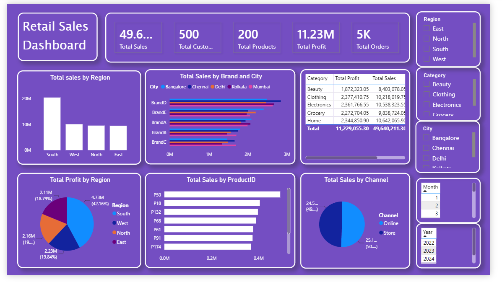
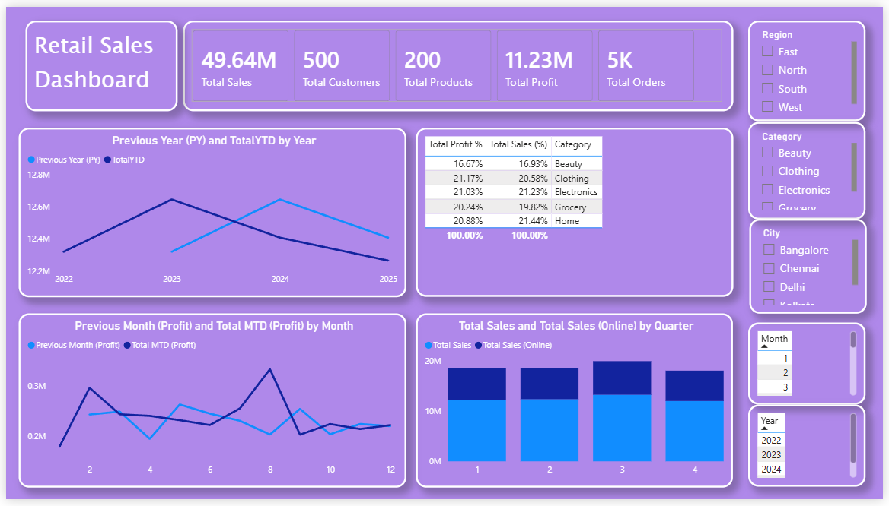

# 📊 Retail Sales Analytics | Power BI

<p align="center">
  <b>Transforming retail data into actionable business insights.</b>
</p>

An interactive Power BI project that explores retail sales, profitability, customer activity, product performance, and sales trends through visual dashboards and analytical reports.

## 🧭 Project Overview

This project uses Microsoft Power BI to analyze retail business performance through interactive dashboards and reports. It combines key performance indicators (KPIs), charts, tables, and slicers to help users explore sales and profit across regions, cities, categories, products, channels, and time periods.

## 🎯 Project Objectives

- Monitor overall sales, profit, customer, product, and order metrics.
- Compare sales performance across regions and cities.
- Analyze product-level and category-level performance.
- Explore monthly, quarterly, and yearly sales trends.
- Compare current performance with previous periods.
- Use interactive filters to investigate different business segments.

## 📌 Key Performance Indicators

| KPI | Value shown in dashboard |
|---|---:|
| Total Sales | 49.64M |
| Total Customers | 500 |
| Total Products | 200 |
| Total Profit | 11.23M |
| Total Orders | 5K |

*These values are displayed as shown in the provided dashboard screenshot.*

## 🖼️ Dashboard Preview

### Retail Sales Dashboard



### Retail Sales Reports



## 📈 Dashboard Features

### Sales Performance
- Total sales by region.
- Sales by brand and city.
- Sales by product ID.
- Sales comparison across online and store channels.

### Profitability Analysis
- Total profit by region.
- Category-wise sales and profit comparisons.
- Percentage contribution of categories to sales and profit.

### Time-Based Analysis
- Monthly sales trends.
- Previous Year (PY) versus Year-to-Date (YTD) comparison.
- Previous Month Profit versus Month-to-Date (MTD) Profit.
- Quarterly sales and online sales comparison.

### Interactive Filtering

The reports include slicers for:

- Region
- Category
- City
- Month
- Year

These filters allow users to explore the report interactively and compare performance across selected segments.

## 🛠️ Tools & Technologies

- **Microsoft Power BI** — Dashboard development and reporting.
- **Data Visualization** — KPI cards, bar charts, line charts, pie charts, tables, and map visuals.
- **Interactive Reporting** — Slicers and report filters.

Power Query and DAX can also be listed here if they were used in the actual project.

## 📂 Project Structure

```text
Retail-Sales-PowerBI/
├── Dashboard.png
├── Reports.png
├── Retail_Sales.pbix
└── README.md
```

Replace `Retail_Sales.pbix` with your actual Power BI file name.

## 🚀 How to Explore the Project

1. Clone or download this repository.
2. Open the `.pbix` file using Microsoft Power BI Desktop.
3. Navigate through the available report pages.
4. Use the slicers to filter data by region, category, city, month, or year.
5. Explore sales, profit, and time-based trends through the visualizations.

> **Note:** The interactive report requires Power BI Desktop. The screenshots provide a quick preview of the dashboard and reports.

## 📚 Key Learnings

Through this project, I gained practical experience in:

- Building interactive business intelligence dashboards.
- Presenting KPIs and performance metrics.
- Comparing sales and profitability across business dimensions.
- Exploring time-based trends through visualizations.
- Communicating data insights through structured reports.

## 👤 Author

**Vamshi Pepalla**

- GitHub: [@Vamshipepalla](https://github.com/Vamshipepalla)
- Email: [vamshipepalla6@gmail.com](mailto:vamshipepalla6@gmail.com)

---

<p align="center">
  <i>Measure performance. Explore trends. Make data-driven decisions.</i>
</p>
